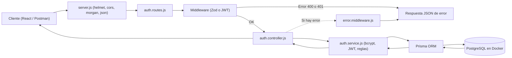

# Guía Completa y Material de Defensa: Backend MVP (`taller_db`)

Este documento recopila **todos los cambios realizados** en el backend del sistema de gestión del Taller Mecánico (`Node.js` + `Express` + `PostgreSQL en Docker` + `Prisma ORM` + `Zod` + `bcryptjs` + `JWT`) y explica **archivo por archivo** cómo funciona cada pieza, **por qué se diseñó así** y **cómo defenderlo** ante un profesor o equipo técnico, incluso si estás empezando en desarrollo backend.

---

## Parte 1: Listado de cambios realizados y qué se logró

### Resumen de logros principales
1. **Migración a PostgreSQL local en Docker sin perder Neon:** El backend ahora corre contra un contenedor local (`postgres_taller`) que carga automáticamente tus 3 scripts SQL (`01DataTypes.sql`, `02Tables.sql`, `03Insert's.sql`), pero manteniendo compatibilidad total con Neon cambiando solo una línea en `.env`.
2. **Integración de Prisma ORM (v6.19.3 estable):** Se modelaron tus 13 tablas y 9 tipos `ENUM` en `schema.prisma`, permitiendo consultar PostgreSQL con JavaScript limpio, tipado y seguro contra inyección SQL.
3. **Sistema completo de autenticación (`Register`, `Login`, `Me`):**
   - Registro de clientes con validaciones estrictas (**Zod**), prevención de duplicados (`409`) y encriptación segura de contraseñas (**bcryptjs**).
   - Inicio de sesión por `email` o `username`, validación de estado de cuenta (`ACTIVE` vs `BLOCKED`/`SUSPEND`/`INACTIVE`), registro de último acceso (`last_access`) y emisión de tokens **JWT**.
   - Middleware de protección de rutas (`Bearer <token>`) y soporte preparado para autorización por roles (`ADMINISTRATOR`, `MECHANIC`, `CUSTOMER`).
4. **Arquitectura profesional por capas y manejo centralizado de errores:** Ninguna capa mezcla responsabilidades, y cualquier error devuelve respuestas JSON limpias y coherentes.
5. **Entorno listo para trabajo en equipo y pruebas:** Se añadieron `.gitignore`, `.env.example`, `README.md`, `request.http` y una colección lista para importar en Postman (`postman_collection.json`).

### Tabla detallada de archivos creados y modificados

| Archivo | Estado | Qué se hizo | Qué se logró |
| :--- | :--- | :--- | :--- |
| `docker/docker-compose.yml` | Modificado | Se quitó `version` (obsoleto), se montó `../database` como `:ro` y se agregó `healthcheck`. Se recreó el contenedor antiguo. | PostgreSQL 16 local levanta limpio y carga automáticamente las 13 tablas, 3 roles y 21 usuarios de prueba. |
| `src/config/db.js` | Modificado | Detección automática de SSL según `DATABASE_URL`. | Funciona tanto con Docker local (sin SSL) como con Neon (con SSL) sin modificar código. |
| `prisma/schema.prisma` | Creado | Definición de los 9 `ENUM`, 13 modelos, relaciones e índices de tu SQL. | Prisma entiende tu base de datos exacta sin alterarla ni perder compatibilidad. |
| `src/config/prisma.js` | Creado | Instancia única (*Singleton*) de `PrismaClient`. | Evita abrir decenas de conexiones innecesarias cada vez que `nodemon` reinicia. |
| `src/models/auth.schema.js` | Creado | Esquemas Zod `registerSchema` y `loginSchema`. | Valida y limpia los datos del usuario antes de llegar a la lógica o a PostgreSQL. |
| `src/middleware/validate.middleware.js` | Creado | Middleware reutilizable `validateBody(schema)`. | Rechaza peticiones mal formadas con HTTP `400` y detalle exacto por campo. |
| `src/utils/password.js` | Creado | Funciones `hashPassword` y `comparePassword` con `bcryptjs`. | Las contraseñas jamás se guardan en texto plano; se protegen con hash + *salt*. |
| `src/utils/jwt.js` | Creado | Funciones `signToken` y `verifyToken` con `jsonwebtoken`. | Emite y verifica tokens firmados con fecha de expiración. |
| `src/utils/AppError.js` | Creado | Clase personalizada `AppError(message, statusCode)`. | Permite lanzar errores de negocio controlados (`401`, `403`, `404`, `409`) desde cualquier servicio. |
| `src/middleware/auth.middleware.js` | Creado | Middlewares `authenticate` y `authorize(...roles)`. | Protege rutas privadas verificando el JWT y deja listo el control de permisos por rol. |
| `src/middleware/error.middleware.js` | Creado | `notFoundHandler` (`404`) y `errorHandler` global. | Atrapa todos los errores (propios, JSON roto, duplicados Prisma `P2002`, fallos `500`) en un solo lugar. |
| `src/service/auth.service.js` | Creado | Lógica de negocio: `registerUser`, `loginUser`, `getUserProfile`. | Reglas de registro, login, sanitización (sin `password_hash`) y consultas vía Prisma. |
| `src/controllers/auth.controller.js` | Creado | Controladores HTTP `register`, `login`, `me`. | Reciben `req`, llaman al servicio y responden JSON con los códigos `201` / `200`. |
| `src/routes/auth.routes.js` | Creado | Enrutador Express para `/register`, `/login` y `/me`. | Conecta cada URL con sus middlewares y controlador correspondiente. |
| `server.js` | Modificado | Se activaron `helmet`, `morgan`, rutas `/api/v1/auth` y manejadores de error. | Punto de entrada limpio, seguro y con logs claros de cada petición. |
| `package.json` | Modificado | Se instalaron Prisma 6, Zod, bcryptjs, JWT y scripts (`db:up`, `db:down`, `prisma:generate`, `prisma:studio`). | Dependencias estables alineadas y comandos cortos para el equipo. |
| `.gitignore` | Creado | Ignora `node_modules/`, `.env`, `uploads/*` y logs. | Evita filtrar contraseñas o subir miles de archivos a GitHub. |
| `.env.example` | Creado | Plantilla segura de variables para Docker, Neon y JWT. | Permite que cualquier compañero configure su `.env` en segundos al clonar el repo. |
| `postman_collection.json` | Creado | Colección Postman v2.1 con scripts automáticos de token. | Pruebas de 1 clic en Postman para todos los endpoints y errores de validación. |
| `request.http` | Modificado | Peticiones listas para REST Client / Thunder Client. | Alternativa directa dentro del editor sin salir del IDE. |
| `README.md` | Creado | Documentación de instalación, Docker, endpoints y Postman. | Guía oficial para el equipo al clonar el repositorio. |

---

## Parte 2: ¿Cómo funciona toda la arquitectura? (Explicación sencilla)

Imagina que tu backend es una **oficina bien organizada**:

1. **`server.js` (El edificio y la puerta principal):** Abre el puerto `3000`, coloca medidas de seguridad (`helmet`), anota quién entra (`morgan`), permite entrar a clientes del frontend (`cors`) y entiende paquetes JSON (`express.json()`).
2. **`routes/` (El directorio de oficinas):** Mira la dirección que pidió el cliente (por ejemplo `/api/v1/auth/register`) y lo envía por el pasillo correcto.
3. **`middleware/` (Los guardias de seguridad en la puerta):**
   - `validate.middleware.js` revisa el formulario con **Zod**: *"¿Falta el correo? ¿La contraseña es muy corta? No pasas (`400`)"*.
   - `auth.middleware.js` revisa el carnet (**JWT**): *"¿Traes un token válido y sin vencer? Si no, no pasas (`401`)"*.
4. **`controllers/` (El recepcionista):** Recibe los datos ya validados, se los entrega al departamento correspondiente (`service`) y devuelve una respuesta amable al cliente (`201 Created` o `200 OK`). **El controlador nunca escribe consultas a la base de datos.**
5. **`service/` (El cerebro / lógica de negocio):** Aplica las reglas reales del taller: revisa si el correo ya existe, encripta la contraseña con `bcryptjs`, guarda el usuario en PostgreSQL usando **Prisma** y genera el **JWT**.
6. **`config/prisma.js` y `prisma/schema.prisma` (El traductor hacia la base de datos):** Traducen código JavaScript (`prisma.users.create(...)`) a SQL seguro y lo ejecutan en PostgreSQL dentro de Docker.
7. **`error.middleware.js` (El departamento de reclamos):** Si en cualquier paso ocurre un error, todo cae aquí para responder siempre un JSON ordenado y nunca tumbar el servidor.

### Flujo de una petición paso a paso



---

## Parte 3: Conceptos clave explicados sin rodeos

### 1. ¿Por qué Docker local además de Neon?
- **Neon** es PostgreSQL en la nube (requiere internet y comparte el mismo servidor).
- **Docker** crea un pequeño contenedor aislado en tu propia computadora con PostgreSQL 16.
- **Ventaja:** Puedes desarrollar sin internet, probar sin miedo a dañar datos en la nube y cualquier compañero que ejecute `npm run db:up` obtiene **exactamente la misma base de datos** (misma versión, mismas tablas, mismos datos de prueba).

### 2. ¿Qué es Prisma ORM y por qué usarlo si ya teníamos `pg`?
- Con `pg` escribes SQL manual (`SELECT * FROM users WHERE email = $1`) y manejas `result.rows[0]` a mano.
- **Prisma ORM** (*Object-Relational Mapping*) lee tu `schema.prisma` y genera métodos en JavaScript como `prisma.users.findUnique(...)` o `prisma.users.create(...)`.
- **Beneficios:**
  - Evita errores de escritura en nombres de tablas o columnas.
  - Previene ataques de **SQL Injection** automáticamente (parametriza todas las consultas).
  - Facilita traer relaciones con `include: { role: true }` sin escribir `JOIN`s largos.
- Conservamos `src/config/db.js` (`pg`) activo en `/api/health` para no perder tu configuración inicial y mantener compatibilidad con Neon/Docker.

### 3. ¿Qué es Zod y por qué validar antes de tocar la BD?
- **Zod** es una librería de validación de esquemas. Define qué forma exacta debe tener el JSON que envía el frontend (tipos, longitudes mínimas/máximas, formato de correo, formato de cédula).
- **¿Por qué no dejar que PostgreSQL valide todo?**
  1. Ahorras viajes innecesarios a la base de datos con basura.
  2. Devuelves mensajes claros y amigables en español por cada campo (`field` + `message`), en lugar de errores crípticos de SQL.
  3. Limpias datos automáticamente (`.trim()` quita espacios accidentales, `.toLowerCase()` normaliza correos).

### 4. ¿Por qué `bcryptjs` (hashing) y NO encriptación reversible?
- Si **cifras** una contraseña (reversible), quien robe tu clave puede descifrar todas las contraseñas de tus usuarios.
- **bcrypt** aplica una función **hash unidireccional** (no se puede revertir a la contraseña original) + un **salt** aleatorio (una cadena única por usuario que hace que dos usuarios con la misma contraseña tengan hashes completamente distintos) + un **factor de costo** (`SALT_ROUNDS = 12`, que hace lento cualquier intento de fuerza bruta).
- Al iniciar sesión, `bcrypt.compare(claveIngresada, hashGuardado)` vuelve a hashear la clave ingresada con el mismo *salt* y verifica si coincide.

### 5. ¿Qué es un JWT (JSON Web Token)?
- HTTP es un protocolo **sin memoria** (*stateless*): el servidor no recuerda quién eres entre una petición y la siguiente.
- Cuando haces Login, el servidor te entrega un **JWT** (una cadena dividida en 3 partes por puntos: `Header.Payload.Signature`):
  - **Header:** algoritmo usado (`HS256`).
  - **Payload:** datos básicos no sensibles (`sub` = ID de usuario, `username`, `email`, `role`, `permission`, y fecha de expiración `exp`). **Nunca se mete la contraseña aquí** porque el payload se puede leer (está en Base64).
  - **Signature:** firma criptográfica creada con `JWT_SECRET`. Si alguien altera aunque sea una letra del payload (por ejemplo cambiar `CUSTOMER` a `ADMINISTRATOR`), la firma deja de coincidir y el servidor rechaza el token inmediatamente.
- En cada ruta privada, el frontend envía el token en la cabecera: `Authorization: Bearer <token>`.

---

## Parte 4: Explicación exhaustiva archivo por archivo

### 1. `docker/docker-compose.yml`
Define el servicio `db` con la imagen oficial `postgres:16`:
- `container_name: postgres_taller`: nombre fijo y fácil de recordar para comandos Docker.
- `restart: unless-stopped`: si reinicias tu PC o falla el proceso, Docker lo levanta solo (salvo que tú lo detengas explícitamente).
- `environment`: crea automáticamente el usuario `postgres`, contraseña `password` y base de datos `taller_db`.
- `ports: "5432:5432"`: conecta el puerto `5432` del contenedor con el `5432` de tu computadora (`localhost:5432`).
- `volumes`:
  - `taller_pgdata:/var/lib/postgresql/data`: guarda los datos de forma persistente aunque apagues el contenedor.
  - `../database:/docker-entrypoint-initdb.d:ro`: **carpeta mágica de PostgreSQL**. La *primera vez* que se crea el volumen vacío, Postgres ejecuta todos los `.sql` en orden alfabético: `01DataTypes.sql` → `02Tables.sql` → `03Insert's.sql`. El `:ro` (*read-only*) garantiza que el contenedor no pueda modificar tus archivos SQL.
- `healthcheck`: ejecuta `pg_isready` cada 5 segundos para confirmar que PostgreSQL realmente ya acepta conexiones.

---

### 2. `src/config/db.js`
Configura la piscina de conexiones (`Pool`) del driver `pg`.
- **Qué se cambió:** antes tenía `ssl: { rejectUnauthorized: false }` fijo. Eso funciona en Neon (que exige SSL), pero **falla en Docker local** (que no usa SSL por defecto).
- **Cómo funciona ahora:**
  ```javascript
  const useSSL =
    connectionString.includes('sslmode=require') ||
    connectionString.includes('neon.tech');
  ```
  Si detecta que la URL es de Neon o pide SSL, activa SSL; si es `localhost` (Docker), lo desactiva automáticamente (`ssl: false`). Así conservas tu configuración de Neon sin romper nada.

---

### 3. `prisma/schema.prisma`
Es el plano maestro que le explica a Prisma cómo está hecha tu base de datos.
- **`generator client`**: indica que debe generar la librería `prisma-client-js` dentro de `node_modules/@prisma/client`.
- **`datasource db`**: especifica `provider = "postgresql"` y lee la dirección desde `env("DATABASE_URL")`.
- **Los 9 `enum`** (`service_state`, `budget_state`, `charges`, `users_state`, etc.): coinciden letra por letra con `01DataTypes.sql`.
- **Los 13 `model`** (`role`, `users`, `brand`, `model`, `vehicle`, `catalog_service`, `service`, `previous_external_work`, `record_state`, `budget`, `budget_detail`, `parts_list`, `notification`): coinciden con `02Tables.sql`, incluyendo:
  - `@unique` en `id_card`, `username`, `email`, `tracking_code`, `brand.name`.
  - `@db.VarChar(...)`, `@db.Decimal(12, 2)`, `@db.Timestamp(6)` para respetar los tipos exactos de PostgreSQL.
  - Relaciones con nombre en `service` (`@relation("service_customer")` y `@relation("service_responsible")`), necesarias porque la tabla `service` apunta **dos veces** a `users` (una para el cliente y otra para el mecánico responsable).
  - `@@index([...], map: "idx_...")` conservando tus 8 índices originales.

---

### 4. `src/config/prisma.js`
Exporta una única instancia de `PrismaClient` guardada en `globalThis`.
- **¿Por qué existe este archivo y no hacemos `new PrismaClient()` en cada servicio?**
  Cada instancia de `PrismaClient` abre su propio *pool* de conexiones a PostgreSQL. Si crearas una nueva por archivo o petición, agotarías el límite de conexiones de la base de datos. Guardarla en un solo módulo (patrón **Singleton**) garantiza una única piscina compartida y eficiente.

---

### 5. `src/models/auth.schema.js`
Contiene las reglas de validación con **Zod** para autenticación:
- **`registerSchema`**:
  - `id_card`: texto obligatorio, sin espacios extra (`.trim()`), entre 5 y 10 caracteres, debe cumplir la expresión regular `/^[VEJGPvejgp]-?\d{4,8}$/` (ej. `V-12345678`) y se convierte automáticamente a mayúsculas (`.transform(val => val.toUpperCase())`).
  - `username`: entre 3 y 50 caracteres, solo letras, números, `.`, `_` o `-`.
  - `first_name` / `last_name`: entre 2 y 30 caracteres (coincidiendo con `VARCHAR(30)` de tu tabla `users`).
  - `email`: limpia espacios, convierte a minúsculas (`.toLowerCase()` para evitar que `Ana@mail.com` y `ana@mail.com` se registren como dos usuarios distintos), valida formato de correo y máximo 100 caracteres.
  - `password`: mínimo 8 caracteres y máximo 72 *(detalle técnico importante: bcrypt ignora bytes más allá de 72, por eso se fija ese tope)*.
  - `phone_number`: opcional/nulo, máximo 15 caracteres (`VARCHAR(15)` en SQL).
- **`loginSchema`**:
  - Permite que el frontend envíe `{ email, password }`, `{ username, password }` o `{ identifier, password }`.
  - `.refine(...)` exige que al menos uno de los tres esté presente.
  - `.transform(...)` unifica cualquiera de los tres en un único campo `{ identifier, password }` para que el servicio no tenga que lidiar con tres casos distintos.

---

### 6. `src/middleware/validate.middleware.js`
Define la función `validateBody(schema)`, que es una **fábrica de middlewares**: recibe un esquema de Zod y devuelve un middleware de Express `(req, res, next)`.
1. Ejecuta `schema.safeParse(req.body)` (no lanza excepción; devuelve `{ success: true, data }` o `{ success: false, error }`).
2. Si falla, mapea `result.error.issues` a un arreglo legible `[{ field, message }]` y responde de inmediato con **HTTP `400 Bad Request`**.
3. Si pasa, sobrescribe `req.body = result.data`. **¿Por qué?** Así el controlador recibe los datos ya limpios (sin espacios extra, correo en minúsculas, cédula en mayúsculas) y además **descarta cualquier campo malicioso extra** que alguien intente colar (como `role_id: 1` o `state: "ACTIVE"`).

---

### 7. `src/utils/password.js`
Encapsula `bcryptjs`:
- `SALT_ROUNDS = 12`: equilibrio estándar de seguridad/rendimiento (tarda ~100–250 ms por hash: imperceptible para un humano, pero devastador para un atacante probando millones de claves).
- `hashPassword(plainPassword)`: genera el hash para guardar en `users.password_hash`.
- `comparePassword(plainPassword, hashedPassword)`: devuelve `true` o `false` comparando la clave del login contra el hash de PostgreSQL.
- **¿Por qué `bcryptjs` y no `bcrypt` nativo?** `bcryptjs` es JavaScript puro: funciona idéntico en Linux, Windows y macOS sin requerir compiladores C++ (`node-gyp`), evitando problemas cuando tu compañero instale en otra máquina.

---

### 8. `src/utils/jwt.js`
Encapsula `jsonwebtoken`:
- `getJwtSecret()`: lee `process.env.JWT_SECRET`. En producción exige que esté definido (lanza error si falta para evitar huecos de seguridad); en desarrollo emite una advertencia clara y usa un respaldo temporal si aún no se configuró.
- `signToken(payload)`: firma el token con expiración configurable mediante `JWT_EXPIRES_IN` (por defecto `8h`).
- `verifyToken(token)`: valida firma y expiración; si fue alterado o expiró, lanza error.

---

### 9. `src/utils/AppError.js`
Extiende la clase nativa `Error` de JavaScript agregando `statusCode` y `details`.
- **¿Por qué es útil?** En `auth.service.js` no tenemos acceso a `res` (porque el servicio no debe depender de Express). Con `throw new AppError('El correo ya está registrado', 409)`, el servicio solo reporta el problema de negocio y el `errorHandler` sabe exactamente qué código HTTP devolver.

---

### 10. `src/middleware/auth.middleware.js`
Contiene dos guardianes de seguridad:
1. **`authenticate(req, res, next)`**:
   - Busca la cabecera `Authorization`.
   - Verifica que empiece con `Bearer ` (estándar HTTP para tokens).
   - Extrae el token y llama a `verifyToken(token)`.
   - Si es válido, guarda los datos decodificados en `req.user` y llama a `next()` para pasar al controlador.
   - Si falta, es inválido o expiró (`TokenExpiredError`), responde **HTTP `401 Unauthorized`**.
2. **`authorize(...allowedCharges)`**:
   - Middleware preparado para el futuro control de roles (RBAC). Ejemplo de uso futuro:
     `router.delete('/:id', authenticate, authorize('ADMINISTRATOR'), deleteController)`
   - Si el `req.user.role` no está permitido, responde **HTTP `403 Forbidden`**.

---

### 11. `src/middleware/error.middleware.js`
Centraliza el manejo de errores en Express:
- **`notFoundHandler`**: se coloca al final de todas las rutas. Si el cliente pide una URL que no existe (ej. `GET /api/v1/inventada`), responde JSON con `404` en lugar de una página HTML fea de Express.
- **`errorHandler(err, req, res, _next)`**: Express reconoce que una función es manejadora de errores **precisamente porque tiene 4 parámetros**.
  - Si es `AppError` → devuelve su `statusCode` y `message`.
  - Si `err.type === 'entity.parse.failed'` → el cliente mandó un JSON mal escrito (una coma de más, llave sin cerrar) → responde `400`.
  - Si `err.code === 'P2002'` → código oficial de Prisma para violación de restricción `UNIQUE` en PostgreSQL → responde `409 Conflict`.
  - Cualquier otro error inesperado → imprime el detalle en la consola del servidor (`console.error`) para que el programador depure, pero al cliente solo le devuelve un mensaje genérico `500` para no filtrar datos internos.

---

### 12. `src/service/auth.service.js`
Es el **corazón lógico** de la autenticación:
- **`sanitizeUser(user)`**: usa desestructuración (`const { password_hash, ...safeUser } = user`) para eliminar `password_hash` antes de devolver el usuario. **Regla de oro:** el hash de la contraseña nunca sale del backend.
- **`buildTokenPayload(user)`**: construye el contenido del JWT (`sub`, `username`, `email`, `role`, `permission`).
- **`registerUser(data)`**:
  1. Busca con `prisma.users.findFirst({ where: { OR: [{ email }, { username }, { id_card }] } })` si ya existe algún conflicto. Si existe, lanza `AppError` con `409` indicando exactamente qué campo está duplicado.
  2. Busca el rol `'CUSTOMER'` dinámicamente en la tabla `role` (en lugar de quemar `role_id = 3` a mano, así nunca falla aunque cambien los IDs). Si la tabla estuviera vacía, crea el rol automáticamente.
  3. Hashea la contraseña con `hashPassword`.
  4. Inserta el usuario con `state: 'ACTIVE'` y trae su relación `role`.
  5. Firma el JWT y retorna `{ user: sanitizeUser(createdUser), token }`.
- **`loginUser({ identifier, password })`**:
  1. Busca el usuario por `email` (en minúsculas) **o** por `username`.
  2. Si no existe → `401 Credenciales inválidas`. *(Por seguridad NO se dice "el correo no existe", para evitar que un atacante descubra qué correos están registrados — enumeración de usuarios).*
  3. Verifica `user.state !== 'ACTIVE'`: si la cuenta está `BLOCKED`, `SUSPEND` o `INACTIVE`, bloquea el acceso con `403`.
  4. Compara la contraseña con `comparePassword`. Si falla → `401 Credenciales inválidas`.
  5. Actualiza `last_access: new Date()` en PostgreSQL (auditoría real usando la columna de tu tabla).
  6. Firma el JWT y devuelve `{ user, token }`.
- **`getUserProfile(userId)`**: consulta en PostgreSQL al usuario por `id` (proveniente de `req.user.sub` del JWT) incluyendo su `role`, y lo devuelve sanitizado.

---

### 13. `src/controllers/auth.controller.js`
Mantiene el código limpio y delgado:
- `register`: llama a `registerUser(req.body)` y responde `201 Created`.
- `login`: llama a `loginUser(req.body)` y responde `200 OK`.
- `me`: toma el ID desde `req.user.sub` (inyectado por `authenticate`), llama a `getUserProfile` y responde `200 OK`.
- En los tres casos, el `catch (error)` simplemente llama a `next(error)` para delegar la respuesta de error al `errorHandler` global.

---

### 14. `src/routes/auth.routes.js`
Usa `Router()` de Express para agrupar las rutas del módulo:
```javascript
router.post('/register', validateBody(registerSchema), register);
router.post('/login', validateBody(loginSchema), login);
router.get('/me', authenticate, me);
```
Fíjate en la lectura de izquierda a derecha:
- En `/register`: primero valida con Zod → luego entra al controlador `register`.
- En `/login`: primero valida con Zod → luego entra al controlador `login`.
- En `/me`: primero verifica el JWT con `authenticate` → luego entra al controlador `me`.

---

### 15. `server.js`
Es el punto de entrada que ensambla todo en **orden estricto** (en Express el orden importa):
1. `dotenv.config()` → carga `.env`.
2. Middlewares globales:
   - `helmet()` → agrega cabeceras HTTP de seguridad (protege contra XSS básico, clickjacking, oculta `X-Powered-By: Express`).
   - `cors()` → habilita peticiones desde tu frontend React/Vite.
   - `morgan('dev')` → muestra en consola cada petición con método, ruta, código y tiempo (`POST /api/v1/auth/login 200 142ms`).
   - `express.json()` → convierte cuerpos JSON en `req.body`.
3. Rutas:
   - `GET /api/health` → diagnóstico rápido de Express + PostgreSQL (`SELECT NOW()`).
   - `app.use('/api/v1/auth', authRoutes)` → prefijo versionado `/api/v1/auth` para todas las rutas de autenticación.
4. Manejadores finales (siempre **después** de las rutas):
   - `app.use(notFoundHandler)` (`404`)
   - `app.use(errorHandler)` (errores globales)
5. `app.listen(PORT, ...)` → abre el servidor.

---

### 16. `package.json`, `.gitignore`, `.env.example`, `postman_collection.json`, `request.http`, `README.md`
- **`package.json`**:
  - `"type": "module"` habilita `import`/`export` modernos (ES Modules).
  - Se alinearon `prisma` y `@prisma/client` a la versión estable `^6.19.3` (evitando incompatibilidades de versiones *release candidate*).
  - Scripts añadidos: `npm run db:up`, `npm run db:down`, `npm run prisma:generate`, `npm run prisma:studio` (interfaz visual web para ver/editar tus tablas de PostgreSQL).
- **`.gitignore` y `.env.example`**: protegen secretos (`.env`) y documentan qué variables necesita cualquier compañero al clonar el repo.
- **`postman_collection.json` y `request.http`**: permiten probar todos los endpoints al instante; en Postman, las peticiones `Register` y `Login` traen un script *Post-response* que guarda el JWT automáticamente en `{{token}}`.

---

## Parte 5: Preguntas típicas de defensa (y cómo responderlas bien)

1. **¿Por qué separaron el backend en Routes, Middleware, Controllers y Services en lugar de poner todo en `server.js`?**
   > Porque aplica separación de responsabilidades: las rutas definen URLs, los middlewares validan y protegen, los controladores manejan HTTP (`req`/`res`) y los servicios concentran la lógica de negocio y el acceso a datos. Así el proyecto es fácil de mantener, probar y escalar en equipo.

2. **¿Puede un atacante enviarme `"role_id": 1` (Administrador) en el JSON de `/register` para hacerse admin?**
   > No, por dos capas de defensa: primero, Zod (`registerSchema`) descarta cualquier campo que no esté definido en el esquema; segundo, el servicio ignora cualquier rol externo y siempre asigna el rol `CUSTOMER` desde la base de datos.

3. **¿Por qué usan `bcryptjs` y no guardan la contraseña encriptada de forma reversible?**
   > Porque las contraseñas deben protegerse con *hashing* unidireccional + *salt* aleatorio. Si alguien roba la base de datos, no puede descifrar las contraseñas originales. Para el login solo comparamos el hash mediante `bcrypt.compare`.

4. **¿Por qué el login responde `"Credenciales inválidas"` tanto si falla el correo como si falla la contraseña?**
   > Para evitar ataques de enumeración de usuarios: si dijéramos *"ese correo no existe"*, un atacante podría descubrir qué correos tienen cuenta en nuestro sistema.

5. **¿Qué pasa si un usuario está `BLOCKED`, `SUSPEND` o `INACTIVE` en la tabla `users`?**
   > El servicio `loginUser` verifica `user.state !== 'ACTIVE'` antes de emitir un JWT y rechaza el acceso con código `403 Forbidden`.

6. **¿Por qué validar con Zod si PostgreSQL ya tiene `NOT NULL`, `VARCHAR` y `UNIQUE`?**
   > Porque Zod valida en la puerta de entrada antes de consumir recursos de la base de datos, limpia/normaliza los datos (`.trim()`, `.toLowerCase()`) y entrega mensajes claros campo por campo para mostrarlos en el formulario de React.

7. **¿Por qué usan JWT en vez de sesiones tradicionales en servidor?**
   > Porque nuestra API REST es consumida por un frontend desacoplado (React y eventualmente React Native). JWT es *stateless*, escalable y permite verificar identidad y rol (`sub`, `role`, `permission`) en cada petición mediante la cabecera `Authorization: Bearer <token>`.

8. **¿Qué pasa si alguien modifica el contenido de un JWT para cambiar su rol de `CUSTOMER` a `ADMINISTRATOR`?**
   > La firma criptográfica del token se calcula con `JWT_SECRET` (que solo existe en el servidor). Al modificar el payload, `jwt.verify()` detecta que la firma no coincide y rechaza la petición con `401 Unauthorized`.

9. **¿Cómo cambian entre la base de datos local en Docker y la nube en Neon?**
   > Solo cambiando la variable `DATABASE_URL` en `.env`. Tanto Prisma como `src/config/db.js` (que detecta SSL automáticamente) funcionan con ambos entornos sin tocar ni una línea de código.

10. **¿Por qué `.env` no se sube a GitHub y cómo trabaja su compañero?**
    > `.env` está en `.gitignore` para no exponer credenciales ni el `JWT_SECRET`. En su lugar se sube `.env.example` como plantilla: el compañero lo copia a `.env`, corre `npm install`, `npm run db:up`, `npm run prisma:generate` y `npm run dev`.

---

## Parte 6: Chuleta rápida de códigos HTTP usados en tu API

| Código | Significado | Cuándo lo devuelve tu API |
| :--- | :--- | :--- |
| **`200 OK`** | Éxito general | `/api/health`, `/login`, `/me` exitosos. |
| **`201 Created`** | Recurso creado | `/register` crea un nuevo usuario en `users`. |
| **`400 Bad Request`** | Petición inválida | Error de validación de Zod o JSON mal formado. |
| **`401 Unauthorized`** | No autenticado | Credenciales inválidas en login, o token ausente/inválido/expirado en `/me`. |
| **`403 Forbidden`** | Sin permiso | Cuenta `BLOCKED`/`SUSPEND`/`INACTIVE`, o rol no autorizado en `authorize(...)`. |
| **`404 Not Found`** | No encontrado | Ruta inexistente o usuario no encontrado en `/me`. |
| **`409 Conflict`** | Conflicto de duplicado | `email`, `username` o `id_card` ya registrados en PostgreSQL. |
| **`500 Internal Server Error`** | Fallo del servidor | Error inesperado o caída de conexión a la base de datos. |
